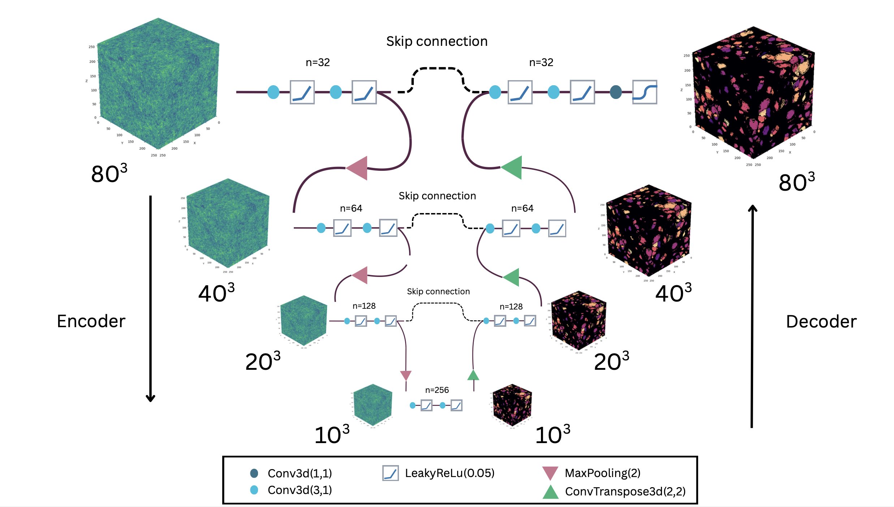
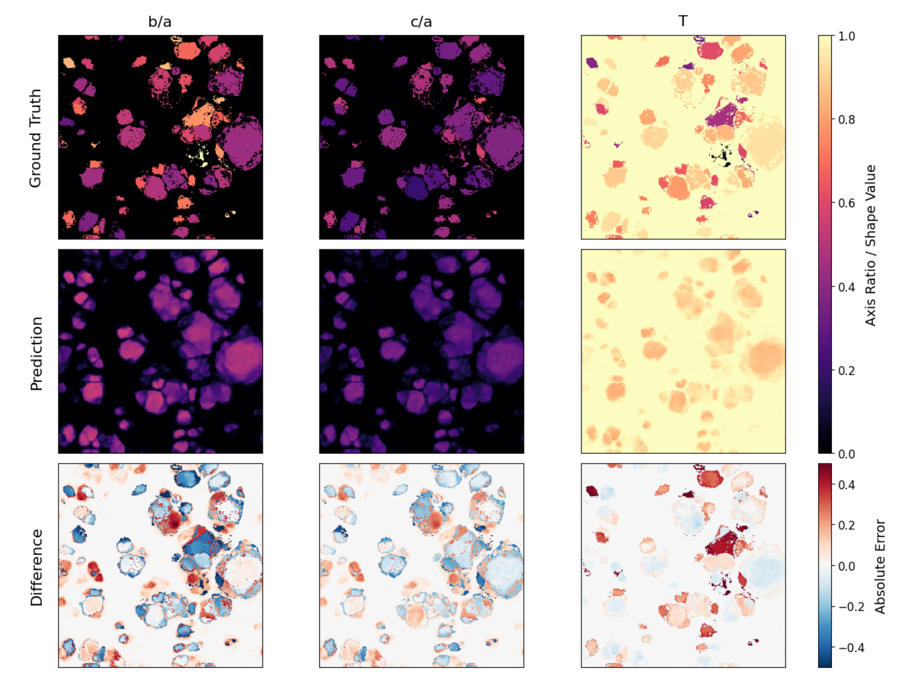

# Predicting Halo Triaxiality in Cosmological Simulations using a CNN

**Final project — Course: Data Science in Astrophysics**  
Institute for Astronomy (IfA), University of Vienna — July 2026

Prof. Oliver Hahn & Ass.-Prof. Dr. Sudeshna Boro Saikia

---

## Overview

The aim of this work is to predict dark matter halo geometry directly from the initial linear density field in N-body simulations using a 3D convolutional neural network (CNN). This work is part of a larger project, where Raffael Jonas investigates the prediction of structural collapse and the halo mass function. 

N-body simulations have demonstrated that dark matter halos formed through gravitational collapse are non-spherical, showing shapes that depend on halo mass, assembly history and cosmic environment. Determining halo geometries accurately is essential because halo shapes directly influence key physical properties and observations, such as subhalo orbital dynamics, spatial anisotropies in satellite galaxy distributions, two-point correlation functions, weak gravitational lensing signals and more. Mapping the origin and distribution of halo shapes therefore provides crucial insights into the non-linear growth of cosmic structure and is vital for accurate cosmological parameter inference.

While N-body simulations provide the ground truth for extracting halo geometries, running full numerical simulations and halo-finding algorithms is computationally expensive. This work applies a machine learning architecture to overcome this computational bottleneck.

Training, validation and test datasets were constructed from cosmological N-body simulations generated with DISCO-DJ (Hahn et al. 2024; List & Hahn 2024), with halos and their axis ratios (*b/a* and *c/a*) identified using the ROCKSTAR halo finder (Behroozi et al. 2012). A 3D U-Net CNN was trained on normalized, augmented sub-volumes using a Mean Squared Error (MSE) loss function.

  

  <em>4-level U-Net structure of the CNN.</em>

While the model successfully identified collapsed regions on large scales, it failed to predict halo axis ratios accurately. Instead, predictions collapsed to the mean near halo centers with artificial, decreasing gradients toward halo boundaries, resulting in negative coefficient of determination values; R² = −2.45 for both axis ratios. Single-sample overfitting diagnostics confirmed that the network struggles to generalize geometric features across independent simulations. Furthermore, masking background voxels to isolate halo shapes caused predicted values to scatter tightly around the dataset mean, resulting in R² ≈ 0. The CNN under this configuration cannot extract physically meaningful halo axis ratios from initial density fields.

  

  <em>Predictions for a slice of one test simulation. The first row shows the ground truth, the second row the predictions and the last row the absolute error between the two. The columns show the results for the axis ratios b/a, c/a and triaxiality T, respectively.</em>

The full methods, results and discussion are written up in a final report: [`DataScience_final_Einramhof.pdf`](DataScience_final_Einramhof.pdf).

---

## Data

The full simulation dataset was generated and stored on a university workstation and is not included here due to its size. 

---

## References

- Behroozi, P. S., Wechsler, R. H., & Wu, H.-Y. 2012, ApJ, 762, 109 — *ROCKSTAR halo finder*
- Hahn, O., List, F., & Porqueres, N. 2024, JCAP, 2024, 063 — *DISCO-DJ*
- List, F. & Hahn, O. 2024, Journal of Computational Physics, 513, 113201

Full bibliography in the report.

---
